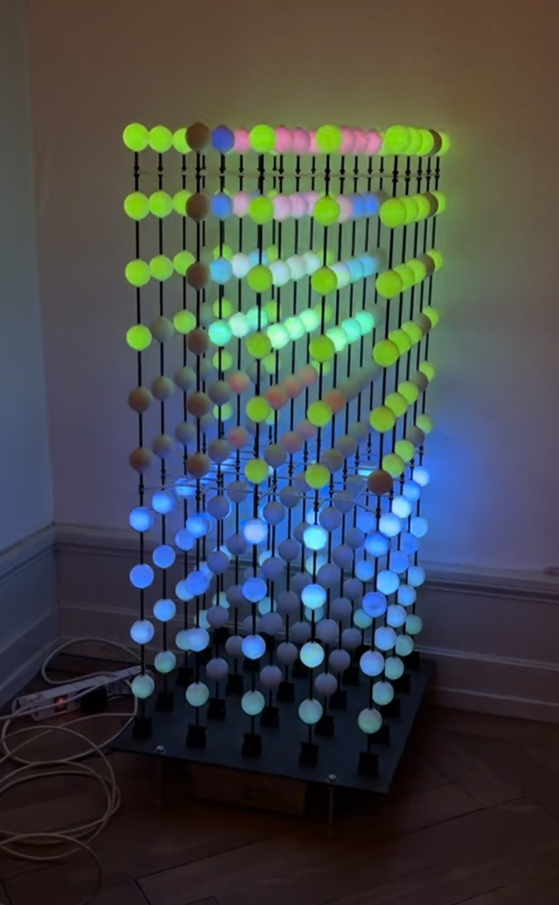

# Nova voxel display control software

Rust-based procedural content generation for the Nova voxel display, with a desktop simulator and a React control interface.

Six content modules explore the low-resolution volume: **Orion's Belt** with a single noise primitive, and **Andromeda**, **Betelgeuse**, **Oort Cloud**, **Pleiades** and **Tannhäuser Gate**, which reinterpret the content of the former Java version. Independent **Brightness** and **Volume** control visual and audio output; **Palette**, **Heat**, **Flow**, **Form** and **Void** shape both. Three instruments, **Strata** for drone and ambient sound, **Fathom** for dub stabs and **Shoal** for bells like a gamelan's, move between cold and warm, ambient and rhythmic, loosely following the content; each content module plays one of them.

This README is the canonical project guidance for both human contributors and coding agents. Follow the control semantics and design constraints below when changing the project.

## Getting started

Run `cargo run --release` in the repository root. The first run creates `nova_settings.json` there; set `"simulator": true` (and `"audio": true` for sound), run again, and open `http://localhost:8080`.

- [Development](doc/development.md): building, hardware output, settings, adding content, troubleshooting
- [Raspberry Pi setup](doc/raspberry_pi_setup.md): installing and running on the display
- [Hardware protocol](doc/nova_protocol.md): packets, timing, and module addressing
- [Audio concept](doc/audio_concept.md): the sound instrument, its mapping and offline sketches

## The display

Nova is a modular RGB voxel LED display driven at 25 Hz (40 ms per displayed frame). The current architecture leaves approximately 20 ms per frame for rendering.

- Each module has a 50 x 50 cm base and is 100 cm high.
- A module contains 5 x 5 x 10 voxels: 250 LEDs.
- Most installations use a single module, configured in the web app. Several modules form a grid that is configured in the settings file only (see [Settings file](doc/development.md#settings-file)); the hardware output supports both.
- Voxels are matte, white, ping-pong-like plastic spheres that diffuse the light.
- Output can be very bright in dark environments.

One module displaying random content:



## Artistic controls

Use one universal control set for all content modules. Keep this order consistent in structs, API payloads, and UI state. Every value ranges from 0 to 1. New installations and Restore defaults start every control at 0.5, except Volume at 0.

| Control                       | Meaning and implementation contract                                                                                                                                                                                   |
| ----------------------------- | --------------------------------------------------------------------------------------------------------------------------------------------------------------------------------------------------------------------- |
| **Brightness** (`brightness`) | Global visual output level. Apply once in the renderer, after content generation; never feed the scaled output back into content.                                                                                     |
| **Volume** (`volume`)         | Independent audio output level, after the complete instrument mix. Zero mutes, with a short click-preventing ramp; musical time continues.                                                                            |
| **Palette** (`palette`)       | One of the curated palettes, by name. In the web app, a tap selects the next one, wrapping around.                                                                                                                    |
| **Heat** (`heat`)             | Gray at 0, the palette as published at 0.5, up to twice its saturation at 1, preserving hue. Does not change occupancy, motion speed, or Form. Single-color modules use it to pick their color instead (see Content). |
| **Flow** (`flow`)             | Evolution rate. Zero freezes the visual composition but retains slow audio evolution; changing the value must not jump either timeline.                                                                               |
| **Form** (`form`)             | Structure, from horizontal layers through columns, blobs and patches to per-voxel grain. Also sets how many palette colors show at once.                                                                              |
| **Void** (`void`)             | Fraction of the volume left dark. Lit voxels keep the same brightness at any value. In sound, thins the spectrum and adds distance, never silence.                                                                    |

### Design principles

- Use the same controls for every module, with creative interpretations that preserve their shared meaning.
- `RenderState` only carries values; it must not remap their semantics. The one exception is tides (below): the renderer moves the effective Heat, Flow, Form and Void slightly around the sliders before content renders. Sliders always show the user's setting.
- Keep the control surface simple. Add presets later if needed.
- The web app shows icons without text labels, so users discover the controls by exploring. `SHOW_LABELS` in `webapp/src/ControlRow.tsx` turns labels on; screen readers always get them. The icons are Material Symbols, Rounded and filled, inlined in `webapp/src/icons.tsx` (Heat a heat haze, Flow a clock with speed lines), so the web app needs no icon package.
- Content and Palette are chosen the same way: a strip as wide as the sliders shows the current choice, its name fades in briefly, and a tap selects the next one, wrapping around. The choice is sent to Nova only after a second without taps, so cycling quickly leaves the display alone; until then the name stays, and it fades once sent. Leaving the page sends a pending choice at once. The content strip sits below Brightness and Volume and shows the module's spectral signature: lines like a star's emission spectrum, placed by a hash of the module's name and drawn in the selected palette's colors (`webapp/src/ContentSignature.tsx`), so every module, including new ones, gets its own. Hide the content strip when fewer than two modules are enabled. A sole enabled module is automatically selected.
- Keep dependencies minimal in both the web app and the Rust crates; prefer existing capabilities for small changes.
- Audio shares Palette, Heat, Flow, Form and Void, with independent Volume. Keep Brightness out of synthesis and Volume out of visual rendering.

## Audio

Audio is experimental: three instruments, each with its own character, shared by the content modules rather than one sound per module. **Strata** is a drone with a pulse under it; **Fathom** plays the drone's chord as dub stabs; **Shoal** plays it on bells, as a gamelan would. Each content module plays one of them (`instruments` in the settings file links them, with defaults in `host/src/state.rs`); selecting another module mixes over to its instrument in 5 s, on the shared musical time. There is no instrument selector in the web app: choosing the instrument is left to a later performer mode. Their design, mapping and open questions are in the [audio concept](doc/audio_concept.md). CPAL drives an independent sample-rate stream on the machine running Nova; browsers only control it.

Strata:

- **Layers**: a drone bed of additive partials in just intonation, slowly beating against detuned twins, over a synth bass on the root; air (noise through narrow resonators tuned to the bed); a pulse of tuned sub thumps, ticks and chord stabs on a 16th-note grid; a tempo-synced dub delay and a long modulated reverb.
- **Palette** sets the tonal world: the colors' mean hue picks the root, each color adds a tone by its hue distance, lightness and chroma. A palette change crossfades to the new tones. The harmony moves in sections of minutes, which end on a phrase start (4 bars): the bass glides between home and the palette's own pitch classes (the fourth and fifth if its tones are all octaves of the root), always the same way for a palette, and halfway one chord tone changes its octave.
- **Heat** goes from cold (thin, glassy, bright air, straight rhythm) to warm (round, low harmonics, breathing and drifting chord tones, swing, saturated thumps, more dub feedback), keeping the pitches and the loudness.
- **Flow** sets how fast the bed evolves and the harmony moves (sections of 2 minutes at Flow 0 to 30 s at Flow 1), and the tempo (80 to 110 BPM) from the slider setting without its tide, so the tempo does not wobble. At Flow 0 the pulse rests and the drone keeps breathing.
- **Form** goes from ambient to rhythmic: pure drone at low Form, then thumps, ticks and stabs growing denser. The conductor plays Strata's score (`strata::SCORE`): patterns whose steps carry weights, of which Form lets more and more play, so they grow by adding steps; they change only at bar boundaries. The drone follows the thumps (`coupling` in Strata's pulse settings, scaled in by Form from 0.2 to 0.6): chord, air and reverb dip and swell back (tight when cold, low and slow when warm, relative to the gap between thumps), and the synth bass gets a short accent, so bass and thump fuse into one. A chord gate lets the drone pulse by itself on the 16th grid (`chord_gate`, from Form 0.25): on the steps the score closes, the chord, air and reverb dip, the chord's upper partials more, like a filter; a hard trance gate when cold, rounder and darker when warm. It plays while the bass is away from home and fades out over a bar when it returns.
- **Void** keeps only the strongest share of partials at constant loudness and moves the sound away (less and darker dry signal, more reverb). It never silences the sound.
- **The image** shapes the sound loosely: every rendered frame hands its effective controls (after the tides) and the content before Brightness to the application, which measures features of the light from it and passes them on. They describe the light, not the display: level, balance, width, height, density, activity and the shares of twelve hues. Instruments answer them in their own way, rarely one to one: the colors of the light lean their chord tones forward or back (`voicing`, up to 3 dB), its height brightens or darkens the chord, sparse light fills Fathom's space with feedback and throws, its echoes start on the side away from the light, visual activity (on a logarithmic scale) animates the bed and the pulse dynamics, and a sudden rise may add one stab or throw. Features are smoothed over seconds; nothing is triggered voxel by voxel. The coupling stays subtle: sound and light should feel related, not the image being played.

Fathom shares the harmony, the bed, the kick, the ticks and the space, and plays the chord differently:

- **Stabs**: the bed's chord, folded into 180 to 720 Hz, plays on off-beat eighths when cold (even 16ths, so swing never moves them, and never on the downbeat, which belongs to the kick) through a resonant low-pass that opens and closes with each hit. Of the chord, only the stab goes into the dub delay, so the echoes carry the groove; between stabs a quiet residual of the chord stays. The patterns are Fathom's score (`fathom::SCORE`) and change only at bar starts, with a little hysteresis. Heat moves them from the skank on the off-beats to syncopation: the third stab pushes into the fourth beat, then the second bar answers the first; the kick gets a ghost before the bar, then plays a one drop (the third beat only) until it fills in again, and the ticks a shaker of 16ths. Between neighbouring patterns the steps blend one at a time. While the bass is away, every pattern moves one warmer (cooler from the warmest), the echoes change from dotted eighths to a quarter or a dotted quarter, gliding like a tape delay, and a slow ride opens the filter. Sparser patterns hit a little harder, so the loudness holds.
- **Palette**, **Flow** and **Void** keep their meaning: the same harmony, sections and tempo; towards Flow 0 the stabs rest like the pulse and their echoes ring out; Void thins the partials and moves the stabs into the echoes and the hall.
- **Heat** goes from glassy resonant pings, whose resonance falls away above 2.5 kHz, with short, bright echoes, to round stabs whose filter closes three times faster than they fade, with swing and darker, more saturated echoes, keeping the pitches and the loudness.
- **Form**: a dark, low-passed drone below 0.15, as loud as Strata's and deeper in the hall than the stabs; gentle swells every second bar; stabs from 0.3, growing denser up to all four off-beats; the kick from 0.4 (half time, then four to the floor) and ticks from 0.5. The hall gets drier as the stabs take over, so they stand out from it.
- **Bass line**: from Form 0.45 a sub (`voices/sub.rs`, a sine with a little of its second and third harmonic, gliding from note to note) takes over the low end from the bed's sustained bass, which steps back within a bar: on the off-beats between the kicks when cold, with octaves and fifths warmer, a dub riff on the one when warm. Its notes are intervals above the root in the score.
- **Fills and breaks**: the last bar of every eighth plays every pattern one warmer; the last phrase of every eighth is a break, where kick, ticks and bass rest while every stab is thrown, and they drop back in with a big throw.
- **Throws** push the dub delay for a moment (more feedback, darker and more saturated repeats): the last stab of every fourth bar (every second while the bass is away), the first stab after a bass or palette change or a sudden rise in visual activity, and now and then when the rhythm loosens; the conductor decides them, from the score. `fathom::Throws::SHORT` is the default; `Throws::LONG` throws far less, for long listening.
- **The image** works as in Strata; visual activity also sets how hard the stabs hit and how far they open the filter.

Shoal shares the harmony, the bed, the kick, the ticks and the space, and plays the chord on bells:

- **Bells** (`voices/bell.rs`): struck bars by modal synthesis, a few inharmonic modes whose upper ones die away faster, each with a twin a few Hz apart, as a gamelan tunes its paired instruments apart so they shimmer. Cold is glass, bright and shorter; warm is bronze, darker, longer and beating wider; soft notes are darker. They go into the dub delay and the hall.
- **Patterns** (`shoal::SCORE`): the notes are degrees of the palette's chord, folded into 300 to 600 Hz and climbing by octaves. Cold, an arpeggio rises over three beats, against the bar; warmer, the even and odd 16ths interlock from the left and the right, like a gamelan's paired parts; warm, a syncopated figure over two bars. Form doubles the elaboration, from one note per beat to eighths and 16ths, from 0.2. Every bass move turns the same patterns into new melodies.
- **Gong**: the same voice, low, slow to speak and ringing for seconds, closes every phrase on the root from Form 0.1, its fifth marking the half from 0.4. The drone sinks below the bells as they grow; a soft half-time kick and off-beat ticks join from about 0.6.

The audio callback must not lock, allocate, log or access files: it reads the controls, the tide clock and the light from the lock-free bus, and the engine smooths everything it reads. Below 120 Hz the output is mono (subwoofers sum their channels); an infrasonic high-pass and a look-ahead limiter at about −1 dBFS precede the smoothed Volume gain, which uses a squared curve for finer low-level adjustment. Output uses the OS default device and its sample rate, with mono downmix when needed, and periods of 2048 frames: on the Raspberry Pi, shorter periods underrun, and since nothing is played live, the added latency only delays the sliders slightly. Audio is off unless `audio` is set in the settings file. Missing/disconnected devices are reported separately from display status and retried without stopping visuals. Dropouts (buffer underruns) are counted and logged but do not restart the stream. A new or recovered stream fades in from silence. First startup and restored defaults use Volume zero; saved nonzero Volume resumes on subsequent launches. The sound is designed for full-range speakers with a subwoofer; begin listening with low speaker/system volume.

Audio is a crate of its own, `audio` (`nova-audio`), which knows neither the host nor the display: it plays from the bus of `nova-core` (see [Development](doc/development.md#project-layout)), which carries the controls as set, the instrument the selected content plays, the tide clock and the features of the light, and applies the global tides itself, as the display does. Inside the crate, each layer uses only those before it:

- `dsp`: building blocks (oscillators, filters, a resonant low-pass for additive partials, envelopes, delay lines, the limiter).
- `voices`: bed, air, thump, tick, stab, dub delay and reverb, each knowing none of the others. The bed can fold its chord into a register, put a resonant low-pass on it and hand it out apart from the bass; the dub delay can be thrown.
- `instruments`: voices played together, registered by name in `INSTRUMENTS`. Strata (`instruments/strata.rs`) is bed, air, pulse and space; Fathom (`instruments/fathom.rs`, its stabs and throws in `fathom/chord.rs`) and Shoal (`instruments/shoal.rs`) use Strata's pulse and space with their own settings. An instrument's constants are a preset, plain data (`strata::Preset`, `fathom::Preset`, `shoal::Preset`), so instruments can share code and differ in their presets. Instruments are an enum, not trait objects.
- `engine`: smooths the controls and features, and runs the conductor (`engine/conductor.rs`: tempo, the grid of 16ths, bars, phrases, sections, the harmony's progression and the audio tides, shared by all instruments; it plays the instrument's score and hands out its hits on every 16th), the instruments and the master (bass management, infrasonic high-pass, limiter, Volume and fade-in).
- `io`: the native output (`Output`), which plays from the bus and leaves its status there.

The engine builds every instrument up front, since the audio callback must not allocate, and plays only the current one, or two while it mixes from one to the next (`MIX_SECONDS` in `engine.rs`): the new one fades in as the old one fades out, both on the shared conductor, which turns to the new instrument's score on the first phrase start past halfway. Asked for again during a mix, the instrument fading out turns back; another one follows once the mix is done.

Beside them, `params.rs` holds the smoothed controls and light the voices read, `harmony.rs` the tonal world of a palette, `score.rs` an instrument's rhythm as data (patterns written as step strings of weights, such as `"9... 5... 7... 5..."`, the Form at which each comes in, and the throws), which the conductor plays, and `signals.rs` the engine's signals: a plain struct, written once per block, through which the conductor hands out tempo, harmony and its changes, whether the bass is away, looseness and onsets, and instruments hand out what others may follow (the drone's dip, the chord gate, the bass accent). Add a signal as a field rather than routing modulation generically. The package profile in the workspace's `Cargo.toml` builds the crate with `opt-level` 2 in debug builds too, so the stream keeps up in real time there. Offline sketches with measurements (`audio/sounddesign/sketches`, an example of the crate) render the engine from scripted controls and from the real content, which only the example renders through `nova-voxel`, a dev-dependency; see [Development](doc/development.md#audio-output). The DSP is plain code without audio dependencies; keep it free of heavily generic abstractions, which can run hundreds of times slower in unoptimized builds and make the stream drop out. The reverb's channel and diffusion-step counts trade quality for cost. Numerical tests do not establish sound quality: tune at installation listening levels and profile with visuals active on the actual Raspberry Pi.

## Content

Modules are registered in `all_content()` in alphabetical order of their names, which is also the order in the web app. Every module's complete specification is the pseudocode at the top of its file in `voxel/src/content/`; keep it in sync with the code. Shared helpers (palette mixing, Heat, Void by rank or as a cap, a deterministic random generator) live in `voxel/src/content/common.rs`.

Preserve readable structures at 5 x 5 x 10, and sample spatial patterns in voxel units so additional modules show more of the same field rather than a stretched one; particle counts scale with the number of modules.

### Orion's Belt (`orions_belt.rs`)

- One 4D simplex noise primitive covers the whole Form range. Form blends five fields that differ only in their per-axis frequencies: layers (Form 0), columns (0.25), blobs (0.5), patches (0.75), and grain (1). Frequencies are fixed, so moving Form never zooms the pattern; blends are normalized to constant contrast.
- Brightness is computed by rank, so Void is exactly the fraction of dark voxels and lit voxels look the same at any Void.
- The structure rises slowly and sways with a slow tide that now and then reverses its direction.
- All motion follows the Flow-integrated phase. Nothing may change the coefficient of that phase, or the pattern jumps; variation over time goes through bounded terms.

### Modules from the Java version

The Java version (branch `nova_final_java_version`) had 27 content classes. They are not ported one by one: overlapping ones are merged into five modules that each span the Form range, and Form, Void and Heat replace their fixed parameters.

| Module (file)                              | Java origins                                   | Form, 0 → 1                                                                         | Void                       | Heat                  |
| ------------------------------------------ | ---------------------------------------------- | ----------------------------------------------------------------------------------- | -------------------------- | --------------------- |
| **Andromeda** (`andromeda.rs`)             | BouncingMetaBalls(T), ColorSplash, Pong, Pong2 | few large, merging, breathing metaballs → many small Pong balls with paddle flashes | by rank (exact)            | saturation            |
| **Betelgeuse** (`betelgeuse.rs`)           | Waves, Waves3D, Sweep, Pulse, Jump, Snow       | bobbing level → rim/core jump → rolling → standing → choppy waves; rain above 0.5   | water level (1 − Void)     | picks the water color |
| **Oort Cloud** (`oort_cloud.rs`)           | Cylinder, Boids, BoidsNr, Snake                | helix orbit → flock → lattice snakes that burst when trapped                        | shorter trails, then a cap | saturation            |
| **Pleiades** (`pleiades.rs`)               | ReactionDiffusion, ReactionDiffusionRandom     | broad spots (cheetah) → stripes → fine pattern                                      | by rank (exact)            | saturation            |
| **Tannhäuser Gate** (`tannhauser_gate.rs`) | Fire, Fire (Old), Stars, Random                | flame bed → flame tongues → rising embers → star flares → sparks                    | lower flames, then a cap   | picks the flame color |

- Simulated modules advance by `advance_seconds()`: simulated time runs in real time at Flow 0.5 and stops at Flow 0. Their randomness is seeded, so a reset replays the same animation.
- Void as a cap (`void_as_cap`) keeps at most the brightest 1 − Void fraction lit, for sparse modules whose dark voxels are already part of the picture.
- Heat as a picker: modules whose Java ancestors had a single color (fire in Tannhäuser Gate, water in Betelgeuse) use Heat to choose that color as a blend sliding through the palette, from its first color at 0 to its last at 1, with neighbouring palette colors for cooler or deeper parts. All other modules keep Heat as saturation.
- Not ported: Test, Solid and Planes, which are test patterns (the calibration page covers them); Colorcube, a gradient through RGB space that palettes and Orion's Belt replace; the cellular automaton CA_Alexander, which at 5 x 10 per slice reads as random flicker; and SSP, a lettering.

## Tides

Tides are slow, subtle variation brought in by the system rather than the user, defined in `core/src/tides.rs`. Each tide is a smooth, bounded swell of two sines with golden-ratio periods, so it never loops exactly and needs no state. Sound receives the effective controls, so it breathes with the light.

- Global tides, applied by the renderer to every content module: Heat (37 s, ±0.08), Flow (23 s, ±0.10), Form (53 s, ±0.06) and Void (29 s, ±0.08). The swing tapers to nothing at 0 and 1, so both extremes stay exact; in particular Flow 0 stays 0.
- Content modules can run their own tides on the same clock (`RenderState::tide_seconds`). Orion's Belt stretches its structures vertically, varies how many colors show at once, and swings which colors dominate.
- The sound reads the clock from the bus, applies the global tides like the display, and its conductor runs its own tide, Looseness (43 s): about half the time the rhythm is strict, otherwise it loosens slightly, with occasional quiet ghost ticks, a few ticks off the beat left out and a little more swing. Thumps and stabs stay exact.
- `FREEZE_WITH_FLOW` (on): the tide clock only advances while Flow is above 0, so Flow 0 keeps the display completely still. `TIDE_DEPTH` scales every tide; 0 switches them off.
- Tides must never change the coefficient of a time term, or patterns jump; they only move bounded values.

## Color and performance

- Palettes are curated sets in `core/src/palettes.rs`, compiled into the binary and listed alphabetically. Colors are specified for light: in OKLCh, as a color temperature for whites, or as sRGB hex for colors taken over from Pantone; a test keeps every OKLCh color within sRGB. Each has 1 to 6 colors (checked at compile time), and names must be unique. The file documents where each value comes from. `doc/palettes.svg` and `doc/palettes.png` show all palettes, each with a strip of its colors as light on black, blended as the display blends them; regenerate the SVG with `cargo test palettes_overview_svg -- --ignored`, and the PNG from it at 2×.
- A separate, slower noise picks palette positions. Neighbouring colors are mixed in Oklab, over only the middle part of the way between them (`BLEND_WIDTH` in `content/common.rs`), so most voxels show palette colors as published and gray or pastel mixes stay short; Heat as a picker (see Content) blends all the way, as a gradient. About two colors show at once for smooth structures and all colors for grain, slowly rotating through the palette.
- Heat preserves hue: it stops increasing saturation before any channel would clip.
- Dark colors drive the LEDs at low power: warm ones vanish, bluish ones survive as dim color, and the bright green LEDs make greens look lighter than on a monitor. `palettes.rs` lists what has held up; evaluate on the physical display.
- Display calibration (`voxel/src/calibration.rs`) maps output values to LED duty cycles per channel: `gain · value^gamma`, applied to the hardware after Brightness. The simulator draws on a monitor with its own gamma, so it stays uncorrected, except while the calibration page shows a pattern: then it previews the calibration. The web app's calibration page (from Settings) adjusts it while the display shows test patterns: gray, red, green and blue ramps of ten steps from bottom to top, and the selected palette as layers. The defaults were measured on the Nova hardware, whose LEDs respond linearly and whose red is the strongest channel: gamma 2.2, gain 0.6 for red and 1 for green and blue. Restore defaults keeps the calibration; Reset calibration returns to these defaults.
- Aim for no more than 20 ms render time per frame on a Raspberry Pi 4 (50 Hz loop). Keep turbulence and noise octaves in check.

## Control API

- Read state: `GET /api/get-state` returns `brightness`, `volume`, `palette`, `heat`, `flow`, `form`, and `void`, plus other settings. Content and palettes are referenced by name: `available-content` lists all content modules, `enabled-content` the enabled ones, `selected-content` the selected one, and `palettes` lists every palette with its colors (`name`, CSS `hex`, the `spec` it is defined by and the `source` it started from, if any) in display order.
- `volume` is reported as -1 while audio is disabled or its output has failed, and the web app then hides Volume. The saved value is kept.
- Update a control: `POST /api/{brightness|volume|heat|flow|form|void}?value=<0..1>` updates its value immediately. Select by name with `POST /api/palette?value=<name>`, `POST /api/selected-content?value=<name>`, and `POST /api/enabled-content?value=<name>,<name>`. `POST /api/flip-vertical?value=<true|false>` flips the content upside down. Unknown names, an empty enabled list, and values that do not parse are rejected with 400 and change nothing; the web app then reloads its state. It also reloads when the page becomes visible again. The web server debounces saving settings by 500 ms; pending changes are not flushed on shutdown.
- `POST /api/reset` queues a one-shot hardware reset. The hardware loop consumes it and reopens the interface to run the module reset sequence; the request is not persisted and has no effect in simulator mode. Modules are reset the same way whenever the set of modules answering status polls changes, for example when the module address changes (`POST /api/module0-address`) or a module powers up after Nova or restarts.
- `POST /api/reload` saves the settings and exits Nova; a process manager such as the systemd service restarts it. Before exiting, the hardware loop runs the module reset sequence so the display stays dark, as it does on Ctrl+C, SIGTERM (e.g. `systemctl stop`) and SIGHUP. A second signal exits right away. A killed or crashed Nova leaves the last frame on the display.
- Calibration: `POST /api/{gamma|gain}-{red|green|blue}?value=<v>` (gamma 1 to 3, gain 0.2 to 1) and `POST /api/reset-calibration`; `get-state` reports `calibration` with `gamma` and `gain` per channel. `POST /api/calibration-pattern?value=<off|gray|red|green|blue|palette>` shows a test pattern instead of content. Patterns are not saved and switch off 10 minutes after the last selection; the calibration page keeps selecting its pattern while visible and switches it off when left or hidden.
- `POST /api/restore` restores default settings. It keeps the display calibration, the Ethernet interface, the web server port, the display and audio status and, with more than one module, the module layout: these can only be configured in the settings file.
- Only `POST` changes anything, and only from Nova's own pages: browser requests whose `Sec-Fetch-Site` is not `same-origin` (or, without it, whose `Origin` names another host) are rejected with 403, so other websites cannot control Nova through a visitor's browser. Requests must also use a local host name: an IP address, a name without dots, or a name under `.local`, `.lan`, `.home.arpa`, `.internal` or `.localhost`, which blocks DNS rebinding. Clients such as curl send none of these headers and are accepted. There is no authentication: anyone on the network can control Nova, so never expose the port to the internet.
- `GET /api/get-status` reports the display status (`status-ok`, `status-message`) and, independently, the audio status (`audio-ok`, `audio-message`).

## Development checks

From the repository root:

```sh
cargo test
npm --prefix webapp run build
cargo build
```

Build the web app before Nova so the embedded UI matches the API. Audio previews and visual diagnostics are described in [Development](doc/development.md). Automated tests and simulator previews do not replace evaluation on the physical display or Raspberry Pi profiling.

The web toolchain supports Node.js 20 (20.19+), Node.js 22 (22.13+), or Node.js 24 and newer. TypeScript stays on 6.0.x because `typescript-eslint` 8.71 supports TypeScript below 6.1; upgrade it to TypeScript 7 only when the lint tooling supports that version. Run `npx --no-install eslint src` from `webapp` to check frontend lint rules.
